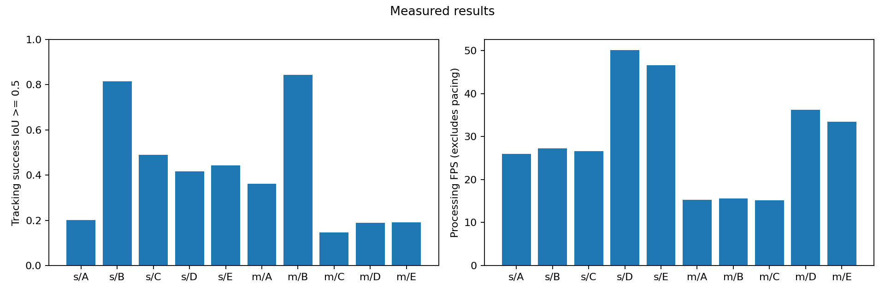

# バスケットボール追跡・中間発表用実験

**2026-10-28追記：過去のEにはKCF初期化の不具合がありました。** `comparison_20261027` と条件Fの比較に含まれる旧Eは、方式の性能評価として再利用しないでください。修正と、固定遅延ありE/G対B/Dの共通条件での再測定は「11. 修正済みE・GとB・Dの比較」に記録します。

目的は、全フレームYOLOに対して、低頻度YOLOの中間フレームをKCFで補う効果を実測することです。
2026-10-27にs/mのA〜Eを実測しました。方法・結果・制約は後半の「8. 実測結果」にまとめています。
続いて条件F（局所特徴点追跡＋移動予測＋適応再検出）を追加しました。方法と再実行手順は「9. 条件F」、測定結果は [Fの実験レポート](reports/2026-10-27-condition-f/README.md) にまとめます。
条件Gでは固定遅延とSystem 1 / System 2を追加しました。「10. 条件G」と [Gの実験レポート](reports/2026-10-27-condition-g/README.md) に方式比較・実測・動画の保存先をまとめています。
得点判定、LSTM、選手追跡、コート変換、3D復元は含みません。

このフォルダ内に学習・推論・評価を新規作成しました。既存コード・元画像・ラベル・動画は参照のみです。
従来の **YOLOv5 v7.0（915bbf294bb74c859f0b41f1c23bc395014ea679）** を使用し、YOLOv5uやYOLO26へ置き換えません。
ColabとWindowsで同じソース、PyTorch 2.5.1／torchvision 0.20.1を使います。
ByteTrackはSupervision 0.25.0の実装です。出典・ライセンスは [THIRD_PARTY.md](THIRD_PARTY.md) に記載しています。

## 1. データセットの配置

Windowsの作業ディレクトリをこのフォルダにします。

```powershell
Set-Location 'D:\自主研究\independent_reserch\basketball_tracking_midterm'
```

確認済みのデータは次の場所です。複製せず、設定から参照します。

| 用途 | 場所・構成 | 確認結果 |
|---|---|---|
| 学習・検証・最終test | `../colab_ball_yolo/dataset/{images,labels}/{train,val,test}` | train 300、val 50、test 58枚 |
| 背景画像 | 上記の明示的な空txtラベル | train 113、val 20、test 28枚。既存資料で確認済み背景 |
| クラス | `data.yaml` | `0: ball`、1クラス |
| 元動画 | dataset/provenance | experiment11／12、時間帯で分割、境界に除外区間あり |
| 連続追跡用動画 | `../編集済み元データ/experiment10_編集.mp4` | 1280×720、30fps、2,512フレーム、83.733333秒 |
| experiment10の元ラベル | `../colab_ball_tracking/bundles/experiment10/data/annotations10.zip` | 1,883フレームに各1個のball矩形 |
| experiment10の位置不明区間 | 629フレーム | 2026-10-26にユーザー確認済みの不可視区間。ボール不在とは断定しない |

データセットtest（58枚）はモデル確定後の**静止画検出評価**です。experiment10は**連続動画の検出・追跡比較**で、役割を分けます。
データセット内の画像・ラベル対応、クラス・矩形範囲、破損、元manifestのハッシュ、split間の完全重複を検査します。
欠損ラベルはエラー、空ラベルは明示的な背景許可が必要です。自動修正・ラベル生成はしません。
今回の408枚は検査を通過し、split間の完全重複はありません。

experiment10と学習元動画のSHA-256一致、provenanceに記録された元フレームの画素ハッシュ一致はありませんでした。
2026-10-26にユーザーから、**experiment10は別の撮影映像で、同じプレーの重複もない**と確認を受けました。
`configs/data_provenance.json` にこの確認と対象動画のSHA-256を保存しています。機械的な完全一致検査と、人手の確認を区別して記録します。
A〜Eの初回実験ではexperiment10を学習元動画と独立した評価映像として扱いました。条件Fはその結果を確認して設計したため、**experiment10での開発実験**です。Fの独立した最終評価とは呼びません。83.733秒の1動画であり、別試合・別体育館への一般化も未確認です。
別動画へ設定を変えた場合、この確認は引き継ぎません。

検査を再実行するコマンド（環境準備は次節）：

```powershell
.\.venv\Scripts\python.exe scripts/audit_data.py --allow-background
```

`data/audit/` に一覧・ハッシュ・検査結果・動画情報が保存され、確認済みのexperiment10ラベルを `data/experiment10_gt.csv` へ変換します。
`--allow-background` は今回の確認済み背景161枚に対する指定です。別データでは確認を引き継がないでください。

## 2. ColabでYOLOv5sを追加学習

1. `colab_upload.zip` をDriveの `マイドライブ/basketball_tracking_midterm/` にアップロードします。このZIPはコードのみです。
2. 既存のデータ入りZIP `../colab_ball_yolo/ball_yolo_colab.zip` をDriveへ置きます。既に置いてあれば再アップロード不要です。
3. `colab/train_yolov5_colab.ipynb` をColabで開き、GPUランタイムを選択します。
4. 上からGPU確認・Driveマウント・専用仮想環境の準備を実行します。GPU種類とVRAMを毎回記録します。
5. `MODEL_SIZE='s'`、`DATASET_ZIP` を実際のDriveパスに指定します。
   ZIP以外では `DATASET_FOLDER` を指定できます。標準ではColabローカルへコピーします。
6. データ検証結果を確認し、学習セルの `RUN_TRAIN=True` で開始します。
7. 完了したrunを `SELECTED_RUN` に指定し、`RUN_VAL=True` でval評価します。
8. valでモデル・運用閾値を確認した後、`VAL_EVIDENCE` にval評価の `metrics.json`、`SELECTION_NOTE` に設定の確認根拠を記載し、`RUN_EXPORT=True` にします。
9. `FINAL_SELECTION` にエクスポートした `final_selection.json` を指定し、`RUN_FINAL_TEST=True` で最終testを実行します。

最初の例はimgsz=960、100 epochs、batch=4、seed=0、patience=20、SGDです。最適化済み設定ではありません。
学習スクリプトのhypは固定YOLOv5の `hyp.scratch-low.yaml` で、実行runにコピーされます。
bestはvalのYOLOv5 fitnessで選択し、testを学習・early stopping・閾値選択に使いません。
データ検査でtest画像の破損・重複は調べますが、test精度は最終評価セルを実行するまで計算しません。
PR/AP評価のconfidence floor=.001と、運用時のconfidenceを区別してください。
valログのPrecision/RecallはYOLOv5側の曲線上の選択閾値に依存し、指定した運用confidenceでの値とは限りません。

VRAM不足ならBATCHを4→2→1と変更して新しいrunで実行し、変更を記録します。
モデルサイズや画像サイズを黙って変更しません。自動バッチ選択は使用しません。
ColabのGPUは固定ではないので、Colabの速度をWindowsの3050 Tiの速度として報告しません。

保存先は `MyDrive/basketball_tracking_midterm/runs/s/日時/` です。
`best.pt`、`last.pt`、`resume_latest.pt`、`results.csv`、曲線、val画像、`opt.yaml`、`hyp.yaml`、
実行ログ、`training_metadata.json`、依存一覧、使用画像・ラベル一覧とハッシュが残ります。
Drive容量を抑えるため、`SAVE_PERIOD=-1`（training.jsonの`save_period=-1`）で、`epoch0.pt`、`epoch1.pt`…の個別保存を無効にしています。
`last.pt`と`resume_latest.pt`は毎epoch同じ名前で更新し、`best.pt`はvalの最良モデルとして更新します。
新規runのweights内の.ptは基本3個で、epoch数に比例して増えません。再開用ファイルの更新中は一時コピー用の空き容量も必要です。
複数runやexportsはそれぞれモデルを持つため、Drive全体の使用量が一定になるわけではありません。
最初のepoch終了前に切断された場合は再開用データがありません。

旧版を使用中の場合は、更新したNotebookを開き直し、再生成した`colab_upload.zip`をDriveの同名ファイルへ置き換えてください。
実行中の学習は自動では切り替わりません。中断から再開する場合、Colabのランタイムを削除して新規接続し、環境・設定・データ準備から実行します。
展開済みコードとZIPの不一致を検査するため、ZIPだけ差し替えた状態で同じランタイムの準備セルを再実行しないでください。
旧版で蓄積した`epoch*.pt`は、この変更では削除しません。空き容量は自動では回復しません。

中断からの再開は、環境・データ準備を再実行し、元runを `RESUME_RUN` に指定して `RUN_RESUME=True` にします。
`resume_latest.pt` はoptimizer、epoch、EMAを含みます。正常終了後のYOLOv5のlast/bestはoptimizerが除かれるため、再開には使いません。
bestだけを初期重みにして別runで続ける追加学習と、optimizerを復元するresumeは別です。完了済みrunをresumeで延長する処理は拒否します。
データやモデルサイズが変わったresumeも拒否します。
再開時も現在の`SAVE_PERIOD`を適用します。YOLOv5が再読込するrun内の`opt.yaml`を更新し、変更前の設定は`opt.before_storage_change.yaml`、保存方針は`resume_storage_policy.json`へ記録します。

## 3. ColabでYOLOv5mを追加学習

`MODEL_SIZE='m'` に変更し、設定セルから再実行して別runを作ります。
公式 `yolov5m.pt` を初期重みとして使用し、sで学習した重みは使用しません。
基本条件はsと共通にし、メモリ不足でbatch等を変更したら両runのmetadataを添えて比較します。
出力先は `runs/m/日時/`、エクスポート先は `exports/m/日時/` です。
Notebookの学習・再開・評価スイッチは初期状態でFalseであり、今回の実装作業では長時間学習を開始していません。

## 4. 重みをWindowsへ配置

最初のオンライン準備で専用環境と公式ソース・初期重みを取得します。
Python 3.12とインターネット接続が必要です。既存プロジェクトの仮想環境は変更しません。

```powershell
powershell -NoProfile -ExecutionPolicy Bypass -File scripts/setup_windows.ps1
.\.venv\Scripts\python.exe scripts/setup_assets.py --sizes s m
.\.venv\Scripts\python.exe -m unittest discover -s tests -v
.\.venv\Scripts\python.exe scripts/check_runtime.py
```

固定した主要依存関係は `requirements.txt` とsetupスクリプトを参照してください。
推移依存も `constraints-common.txt` で固定し、今回確認したWindows環境全体は `requirements-lock-windows.txt` に保存しています。
`opencv-contrib-python` のみを使用し、他のOpenCV wheelを重ねてインストールしません。
SupervisionはOpenCV wheelの競合を避けるため `--no-deps` で導入し、必要な依存はrequirements側で用意します。
このためpip checkのOpenCVディストリビューション名に関する警告と、実際のcv2/KCF利用可否は区別します。
再現用の実際の全依存バージョンは各runの `environment.txt` に保存します。

Colabのexportsフォルダを丸ごとダウンロードし、次の配置にします。

```text
weights/
  pretrained/yolov5s.pt  （setup_assetsで公式v7.0を取得）
  pretrained/yolov5m.pt
  finetuned/s/best.pt
  finetuned/s/best.pt.metadata.json
  finetuned/s/final_selection.json
  finetuned/m/best.pt
  finetuned/m/best.pt.metadata.json
  finetuned/m/final_selection.json
```

exports内の学習設定・val/test結果も一緒に残します。
`configs/experiment.json` のimgsz・confidence・nms_iou・halfを `final_selection.json` に合わせ、`selection_split` を `val` にします。
未調整COCOはsports ballの32、追加学習済みはballの0です。重みのSHA-256・クラス・サイズ・YOLOv5 commitを照合します。
追加学習済み重みと選択設定が未配置ならB〜Eは実行できません。未調整重みで代用しません。
s/mでval選択設定が違う場合は、設定JSONを別名で2つ用意して個別に実行します。

体育館へ移動する前にソース・必要な重み・依存・CUDA・KCFの確認を終えてください。
実験runnerは既存のローカルファイルだけを読み、重みの自動取得・依存の自動インストールをしません。
必要なら `--offline-guard` を付けると、実行中のPythonからのインターネット接続を拒否して確認できます。

## 5. experiment10の比較実験

| 条件 | 実装 | 最終対象選択 |
|---|---|---|
| A | 未調整YOLO、毎フレーム | ball候補の最高信頼度。過去位置・IDを使わない |
| B | 追加学習YOLO、毎フレーム | Aと同じ単純選択 |
| C | 追加学習YOLO＋ByteTrack、毎フレーム | 現在出力のある前IDを優先、なければ最高信頼度の追跡候補 |
| D | 追加学習YOLO、3フレームごと＋直前矩形保持 | 距離・経過時間・弱いIoU項で対応付け |
| E | 追加学習YOLO、3フレームごと＋KCF | Dと同じ再検出対応付け。YOLOでKCFを初期化・補正 |

B〜Eは同じサイズ内で同じ学習済み重み・imgsz・候補抽出設定です。
NMS後・最終対象選択前のYOLO候補をconfidence≥.001で保存します。A/B/D/Eの最終選択は共通confidence（初期値.25）以上です。
CはByteTrackの低信頼度対応付け用に **confidence>.1** の候補を残し、高信頼度閾値は `byte_activation_threshold`（初期値.25）です。
固定Supervision版の新規トラック開始閾値はactivation+.1です。これらは共通の検出候補抽出とは別の追跡設定として記録します。
最終追跡が出ていないlostトラックのKalman予測だけを位置出力にはしません。
KFのdtは1動画フレームで、Cだけを毎フレーム更新します。D/Eの間欠検出に同じKFを流用しません。

30fps／interval=3では0,3,6,…フレームでYOLOを実行し、名目10Hzです。実行回数と実現頻度も記録します。
低頻度の意味は「動画時間当たりの呼び出し頻度」であり、処理が実時間に間に合うという意味ではありません。

D/Eの初期化・ロスト後は最高信頼度から開始します。追跡中は現在位置から
`association_base_px + association_speed_px_s × 前回YOLO採用からの秒数` の距離内で対応付けます。
非重複の高速ボールも候補になり、距離・IoU・信頼度で順位を付けます。正解ラベルは参照しません。
予定したYOLOフレームで候補なし／対応付け失敗なら即座にlostとし、古い矩形を保持しません。
前回YOLOから `max_age_s`（初期値0.3秒）を超えた位置も出力しません。
KCF失敗・範囲外はlostです。KCFの成功フラグは対象が正しい保証ではなく、YOLOと同じ信頼度も作りません。
KCFが扱う座標も元画像です。YOLOはletterbox後に元画像のxyxyへ戻します。

まず、配置済みの未調整sだけを明示的に実行できます。

```powershell
.\.venv\Scripts\python.exe scripts/run_experiment.py --sizes s --conditions A
```

学習済みsを配置し、設定を合わせた後：

```powershell
.\.venv\Scripts\python.exe scripts/run_experiment.py --sizes s --conditions A B C D E
```

mも用意できた場合：

```powershell
.\.venv\Scripts\python.exe scripts/run_experiment.py --sizes s m --conditions A B C D E
```

描画・動画保存なしは `--no-video`、短い動作確認は `--max-frames 120` です。
部分処理結果は `complete_video=false` と記録し、全動画評価として扱いません。
最大速度で全フレームを順番に処理し、フレーム間引き・並列化・未来情報による補正は行いません。
`--allow-version-mismatch` は別環境のスモーク確認に限る明示オプションで、結果に非固定環境と記録します。

比較表は実際に完了したrunだけを指定します。存在しない条件の値は補いません。

```powershell
.\.venv\Scripts\python.exe scripts/compare_results.py --runs results/s_A_日時 results/s_B_日時 results/s_C_日時 results/s_D_日時 results/s_E_日時 --output results/comparison_s
```

入力、重み、設定、環境、保存有無が異なる場合や部分処理の場合は比較上の問題として出力します。
動画保存あり／なし、実時間ペース／最速、CPU／GPU、異なるGPUの結果は分けます。
検出・画像キャッシュは使いません。OSファイルキャッシュは制御していないため、その旨を記録します。

## 6. 正解がある場合の精度評価

experiment10には正解があるので、通常は実行後に自動評価します。
629フレームは確認済み不可視ですが、画面外／遮蔽／ボール不在の区別はないため `unknown_position` にします。
位置精度の分母は1,883フレームです。不可視区間に出た矩形は別集計し、FPと断定しません。

正解CSVは0始まりの `frame_id,timestamp_s,status,x1,y1,x2,y2,segment_id,note` です。座標は元画像のピクセル単位、時刻はframe_id/fpsです。

| status | 意味 | 矩形 | 検出／位置精度への使用 |
|---|---|---|---|
| visible | 人手でボール位置を評価できる | 必須 | 使用 |
| absent | 人手で対象ボール不在を確認 | 空欄 | 検出FPを判定。TSRの分母から除外 |
| unknown_position | 完全遮蔽・画面外などで位置不明 | 空欄 | 位置評価・検出FP/FNから除外 |
| unannotated | 未確認 | 空欄 | 除外 |

疎なCSVの欠落行はunannotatedです。欠落をabsentに変換しません。
人手で全フレームを確認して矩形と状態を付けます。YOLO自身の出力を正解にはしません。
別動画やラベルを編集した場合、対応するmetadataの動画・CSVハッシュも更新して整合性を保ってください。
metadataなしの独自CSVも受け付けますが、動画対応・状態・時刻・座標検査は行います。

正解がまだない別動画は、configのvideoを指定して `--no-gt` を付けると推論・動画・処理時間のみ計測できます。
後日人手正解ができた場合は、YOLOを再実行せず保存出力を評価できます。

```powershell
.\.venv\Scripts\python.exe scripts/evaluate_saved.py --run results/s_A_日時 --gt data/experiment10_gt.csv --output results/reevaluated_A
```

検出は候補とGTを信頼度順に1対1で対応付け、IoU≥.5でTPとします。
本物を見逃してリングだけを誤検出した場合はFP=1、FN=1です。Precision・Recall・F1は運用confidenceで計算します。
AP@.5は候補floor以上のNMS後候補による101点補間PRです。KCF・保持出力にはPRを計算しません。
D/Eの検出PR/APは**YOLO実行フレームのみ**で、毎フレーム条件と評価フレーム集合が違います。
検出しなかった中間フレームを含む方式全体の比較には、共通のGT上の追跡TSRを使います。

TSRはIoU≥.3と≥.5を出力し、位置評価可能な全フレームを分母にし、未出力も失敗に数えます。
CLEは「位置評価可能かつ出力あり」の全フレームで計算し、誤追跡も含めます。件数・平均・中央値・95パーセンタイルと出力率を併記します。
連続失敗時間（IoU<.5）と連続未出力時間は、連続したvisible区間内だけを数えます。
不可視・未アノテーション・segment境界で区切るため、遮蔽をまたぐ真のロスト時間や復帰時間ではありません。
シュート境界未注釈や疎な正解の場合、時間指標には制約があります。ROCやTN不明なAccuracyは主指標にしません。

## 7. 任意の15分ループ安定性試験

83秒の動画の1回処理と、15分試験は別です。必要な場合だけ次を実行します。

```powershell
.\.venv\Scripts\python.exe scripts/run_experiment.py --sizes s --conditions E --loop-seconds 900 --realtime --no-video
```

同じexperiment10を元動画fpsのペースで反復し、ループ境界で追跡状態・検出スケジュール・軌跡をリセットします。
処理が遅い場合はフレームを落とさず遅れを記録します。意図した待機時間と処理時間を分けます。
これは**同じ映像の反復による処理安定性試験**であり、独立した15分映像の精度評価ではありません。
精度集計は最初の1周だけを使い、同じ正解を反復して標本数を増やしません。
83秒の1回結果から15分の安定性は保証しません。許容表示遅延だけで処理能力不足が解消するとは扱いません。

## 出力と時間計測

各runは別ディレクトリに保存します。

| ファイル | 内容 |
|---|---|
| run_config.json / environment.txt | 実行コマンド、設定、GPU、ライブラリ、重み・入力・自作ソースのハッシュ |
| candidates.jsonl | NMS後の全ball候補、YOLO実行有無、frame_id、cycle |
| tracking.jsonl / tracking.csv | 最終矩形、track_id、初期化・補正・追跡・保持・lost、情報源、時刻 |
| timing.csv | 前処理・推論・後処理・追跡・描画保存・ログ/計測の時間、待機・遅れ |
| metrics.json / summary.csv | 検出・追跡・性能の集計と分母・制約 |
| per_frame.csv / detector_pr.csv | GT対応、IoU、CLE、成功判定、PR点 |
| tracked.mp4 | 元fpsで保存した矩形・軌跡・状態表示動画 |
| tracking_metrics.png / detector_pr.png | 時系列と検出PR |
| failures/ | 出力あり・低IoUの代表例。誤対象か位置ずれかは目視で確認 |
| telemetry.json | nvidia-smiのGPUメモリ・温度などの定期値 |
| status.json | initializing / complete / failed、部分処理の区別 |

GPU段階の前後でCUDA同期します。前処理はletterbox・テンソル化・転送、推論はforward、後処理はNMS・座標復元・CPU取得です。
ウォームアップ3回は別記録で動画中のYOLO回数に含めません。
全体時間は読込・追跡・描画保存・ログ・ハードウェア計測を含み、モデル読込／ウォームアップと終了後の評価・グラフ作成は除外します。
処理時間の平均・中央値・95パーセンタイル、PyTorchの最大GPUメモリ、取得できた温度を保存します。
`processing_fps` は意図した実時間待機を除き、`wall_fps` は待機を含みます。
全フレーム検出は30fps達成を意味しません。これらはオフライン処理の時間であり、撮影から表示までの遅延ではありません。

## 実装確認・再生成

```powershell
.\.venv\Scripts\python.exe -m unittest discover -s tests -v
.\.venv\Scripts\python.exe scripts/build_colab.py
```

重要テストはクラス・座標範囲、letterbox座標往復、0始まりのフレーム時刻、検出間隔、1対1のTP/FP/FN、
未出力を含むTSR、欠損／空ラベル、重複、KCF・ByteTrack・lost処理、再開用チェックポイント保存を対象にしています。
検証の実施結果と未実施項目は `VERIFICATION.md` に記載します。

最初に行う操作は **ColabへコードZIPと既存データZIPを用意し、YOLOv5sを追加学習すること**です。
Windows側の全条件比較は、s/mそれぞれの追加学習とvalでの設定確定後に実行してください。

## 8. 実測結果：2026-10-27（日本時間）

s/mの追加学習済みモデルを受領し、重み・学習記録・val結果のハッシュを検証しました。
両モデルは同じtrain/val/test（300/50/58枚）と主要学習条件（imgsz=960、最大100 epochs、batch=4、seed=0、patience=20、SGD）です。
mは省容量版のsave_period=-1、sは旧版の1で学習されています。これはepoch別の重み保存方針の差で、学習条件の変更ではありません。
両方のColab学習GPUはTesla T4です。以下の動画性能はWindowsのRTX 3050 Ti Laptop GPU 4GBで測定しました。

### 実行方法と固定条件

mのB〜Eを各120フレームで動作確認後、全10条件をm/A〜E、s/A〜Eの順にGPUで逐次実行しました。
前日の測定値は今回の表に混ぜていません。各条件は1回測定です。
入力960、confidence=0.25、候補floor=0.001、NMS IoU=0.45、FP32、動画描画・保存あり、検出・画像キャッシュなし。
`final_selection.json`の初期設定を固定しており、experiment10の結果を見て閾値を調整していません。追跡パラメータも初期設定です。
D/Eは3フレームごとの検出で、838回（毎フレーム条件2,512回の約1/3）。元動画時間上の名目頻度は10Hzです。
GPUは各段階の前後で同期し、ウォームアップ3回は計測から除外しました。

```powershell
Set-Location 'D:\自主研究\independent_reserch\basketball_tracking_midterm'
.\.venv\Scripts\python.exe scripts/check_runtime.py
.\.venv\Scripts\python.exe scripts/run_experiment.py --sizes m --conditions B C D E --max-frames 120 --offline-guard --output results/smoke_m_20261027
.\.venv\Scripts\python.exe scripts/run_experiment.py --sizes m s --conditions A B C D E --offline-guard --output results/comparison_20261027
```

実行フォルダ名の日時はUTCです。`20261026T15...Z`は日本時間2026-10-27に対応します。

### 位置精度と処理速度

共通の位置評価対象は1,883フレーム。未出力もTSRでは失敗として数え、不可視629フレームは位置不明として除外します。
CLEは出力がある位置評価可能フレームすべて（誤対象を含む）の平均で、未出力は含まず、対象件数を併記します。

| サイズ | 条件 | TSR≥0.3 | TSR≥0.5 | CLE平均px（件数） | 出力率 | 処理fps | YOLO回数 |
|---|---|---:|---:|---:|---:|---:|---:|
| s | A | 31.70% | 20.18% | 87.11（860） | 45.67% | 25.94 | 2512 |
| s | B | 86.51% | 81.47% | 8.08（1665） | 88.42% | 27.21 | 2512 |
| s | C | 52.31% | 48.86% | 10.09（1007） | 53.48% | 26.57 | 2512 |
| s | D | 61.29% | 41.64% | 15.28（1656） | 87.94% | 50.11 | 838 |
| s | E | 60.44% | 44.34% | 13.92（1362） | 72.33% | 46.61 | 838 |
| m | A | 49.81% | 36.06% | 58.08（1124） | 59.69% | 15.26 | 2512 |
| m | B | 89.11% | 84.23% | 64.81（1839） | 97.66% | 15.56 | 2512 |
| m | C | 16.68% | 14.60% | 625.66（1739） | 92.35% | 15.22 | 2512 |
| m | D | 27.46% | 18.80% | 445.20（1803） | 95.75% | 36.24 | 838 |
| m | E | 25.81% | 19.01% | 487.55（1692） | 89.86% | 33.50 | 838 |



A=未調整YOLO、B=追加学習YOLO、C=追加学習YOLO＋ByteTrack、D=3フレームごとYOLO＋位置保持、E=3フレームごとYOLO＋KCF。

### 仮説に対する今回の結果

- **s**：EのTSR@0.5はDに対して+2.71ポイント、Bに対して-37.12ポイント。Eの処理fpsはBの1.71倍でした（この1回の測定）。
- **m**：EのTSR@0.5はDに対して+0.21ポイント、Bに対して-65.22ポイント。Eの処理fpsはBの2.15倍でした（この1回の測定）。

DとEは同じ検出間隔・重み・共通設定なので、この差がKCFで中間フレームを補った効果を示します。
一方、Bとの差は残るため、速度と精度の両方で判断します。単一動画・単一測定で一般的な優位性は断定しません。
今回のEはDよりTSR@0.5がわずかに改善しましたが、TSR@0.3と出力率は低下しています。KCF追加による一律の改善は確認できません。
両サイズともBとの精度差が大きく、「全フレーム検出に近い精度を保って低負荷化する」という目標には、現状の設定では達していません。
Cも対象選択・トラック成立条件によりBより成功率が下がることがあります。追跡を追加すれば必ず改善するわけではありません。

今回のm/Cではframe 651（21.7秒）で、正解ボールから離れた画面左下の枠をtrack_id=175として継続していることを目視確認しました。
ログではID175を701フレーム、ID344を1,143フレームで出力しています（不可視区間の出力も含む）。
現行Cは同じID、D/Eは過去位置との近さを優先するため、背景の誤検出を継続する問題があります。
これは現在の検出器・パラメータ・単一対象選択規則を組み合わせた条件の結果であり、ByteTrackやKCF一般の性能の結論ではありません。
Bについても、mは成功率だけでなくCLE・誤検出数・速度をsと合わせて判断してください。mの大型化がすべての指標を改善するとは限りません。

### 生の検出評価（最終1個の位置出力とは別）

| サイズ | 条件 | Precision | Recall | F1 | AP@0.5 | 検出評価フレーム |
|---|---|---:|---:|---:|---:|---:|
| s | A | 0.3833 | 0.2119 | 0.2729 | 0.1690 | 1883 |
| s | B | 0.8344 | 0.8216 | 0.8279 | 0.8426 | 1883 |
| s | C | 0.8344 | 0.8216 | 0.8279 | 0.8426 | 1883 |
| s | D | 0.8382 | 0.8195 | 0.8288 | 0.8405 | 626 |
| s | E | 0.8382 | 0.8195 | 0.8288 | 0.8405 | 626 |
| m | A | 0.5286 | 0.3675 | 0.4336 | 0.3088 | 1883 |
| m | B | 0.4175 | 0.8593 | 0.5620 | 0.8176 | 1883 |
| m | C | 0.4175 | 0.8593 | 0.5620 | 0.8176 | 1883 |
| m | D | 0.4195 | 0.8530 | 0.5624 | 0.8264 | 626 |
| m | E | 0.4195 | 0.8530 | 0.5624 | 0.8264 | 626 |

D/Eの検出PR/APはYOLOを実行したフレームだけです。A〜Cとは評価フレーム集合が異なるため、方式全体の精度比較は上表の共通TSRで行ってください。
KCFや位置保持には検出confidenceを付与せず、それらの出力から検出PR曲線を作っていません。

### Colabの静止画val/test（ユーザー実行済み結果）

| サイズ | split | Precision | Recall | AP@0.5 | AP@0.5:0.95 |
|---|---|---:|---:|---:|---:|
| s | val | 0.8431 | 0.8960 | 0.9053 | 0.3928 |
| s | test | 0.8581 | 0.8066 | 0.9221 | 0.5218 |
| m | val | 1.0000 | 0.9311 | 0.9861 | 0.4043 |
| m | test | 0.8894 | 0.8667 | 0.9051 | 0.5062 |

ここはColabの保存結果を確認したもので、Windowsで静止画testを再実行していません。
ColabのPrecision/RecallはYOLOv5が選ぶ曲線上の閾値に依存し、運用confidence 0.25での値とは限りません。
Colab評価はNMS IoU=0.6、動画運用は確定済みの0.45です。画像集合も違うため、testとexperiment10の値を同一条件として比べないでください。

### 結果の検証と保存先

全10条件で、動画を最後までデコードし2,512フレームを確認。候補・最終出力・CSVのフレーム対応、元動画時刻、
毎フレーム／3フレームごとの実際のYOLO回数、元画像座標、保持／KCF出力のconfidenceが空であることを検査しました。
全条件で保存済み予測から検出・追跡指標を再計算し、初回評価と完全一致しました。

```powershell
$comparisonRuns = @(Get-ChildItem -LiteralPath 'results/comparison_20261027' -Directory | Sort-Object Name | ForEach-Object { $_.FullName })
.\.venv\Scripts\python.exe scripts/verify_experiment_runs.py --runs $comparisonRuns --output results/comparison_20261027/verification.json
.\.venv\Scripts\python.exe scripts/compare_results.py --runs $comparisonRuns --output results/comparison_review
```

再実行時は、同じ親フォルダに複数回のrunを混ぜず、今回比較するrunだけを指定してください。比較表の出力先は未使用のフォルダ名にします。

- GitHubにも収録：[比較CSV](reports/2026-10-27/comparison.csv)、[比較JSON](reports/2026-10-27/comparison.json)、[全run検証記録](reports/2026-10-27/verification.json)、[モデル照合記録](reports/2026-10-27/model_audit.json)。
- 各条件の集計・実行設定・GPU計測は `reports/2026-10-27/s_A/`〜`m_E/`、Colab記録は `reports/2026-10-27/models/` に収録。
- 元の動画・全候補・フレーム別CSV・失敗画像はローカルの `results/comparison_20261027/<run名>/` に保存。実際のrun名は比較CSVを参照。
- 重み・元動画・仮想環境・大容量のフレームログはGitHubに含めません。GitHubのコードだけで再実行するには、README前半のデータ配置と重み配置が必要です。

### 解釈上の制約

- 同じ83.733秒の1動画を各条件1回測定しています。実行順は固定で、電力状態・温度・OSキャッシュを完全には制御していません。速度差は今回の実測値として報告し、統計的な優位性は主張しません。
- 処理fpsは動画の読込・描画保存・ログ・計測を含み、モデル読込・ウォームアップ・終了後の評価と作図を除きます。動画の再生fpsや撮影から表示までの遅延とは違います。
- 全体fpsが30を超えても各フレームの処理期限を満たす保証ではありません。特にD/Eは検出フレームと中間フレームで時間が異なります。
- GPUメモリ・温度・処理時間の平均／中央値／95パーセンタイルは各条件のmetrics.jsonとtelemetry.jsonに保存しています。
- 連続ロスト指標は位置評価可能な連続区間だけを数え、不可視区間をまたぐ真の再捕捉時間ではありません。
- 15分反復安定性試験、独立した別試合・別体育館での評価、Colab切断からの実optimizer再開は今回未実施です。
- `VERIFICATION.md`と`EVALUATION_B.md`は以前の時点の記録です。今回のs/m比較は本節と2026-10-27のreportsを参照してください。

## 9. 条件F：局所特徴点追跡・移動予測・適応再検出

FはBと同じ追加学習済みYOLOを使い、検出しないフレームを局所Lucas–Kanade（LK）特徴点追跡で補います。
実装は `src/adaptive_tracking.py`、設定は `configs/experiment_f.json`、入口は既存の `scripts/run_experiment.py` です。
KCFを使うEは比較用に残しています。人物検出・保持者の特定・姿勢推定・3D物理モデルはFに含めていません。

experiment10を全2,512フレーム処理し、同じ実行環境でB/Eも測り直しました。TSR@0.5は1,883可視フレームを共通分母とする追跡成功率です。

| モデル | 条件 | TSR@0.5 | 処理fps | YOLO回数 |
|---|---|---:|---:|---:|
| s | B | 81.47% | 12.56 | 2,512 |
| s | E | 44.34% | 27.76 | 838 |
| s | F | **77.85%** | **18.25** | **1,076** |
| m | B | 84.23% | 9.03 | 2,512 |
| m | E | 19.01% | 19.94 | 838 |
| m | F | **77.43%** | **15.94** | **1,109** |

s/FはBとの差が-3.61ポイント、速度はBの1.45倍、YOLO回数は57.17%減でした。Eからは+33.51ポイント改善しましたが、速度はEの0.66倍です。
m/FはBとの差が-6.80ポイント、速度はBの1.77倍でした。今回のF同士ではsが精度・速度ともに上回っています。
この1動画でBと同等の精度になったとは断定しません。Fは今回のGPU環境でも30fpsに届いておらず、小型CPU端末は未検証です。
前節の初回測定とは処理速度が異なるため、上表では今回測り直したB/Eだけと比較しています。実行順はs/F→s/B→s/E→m/F→m/B→m/Eの各1回です。

### Fの処理

1. ボール枠の内部から最大30点の特徴点を選び、現在と直前の画像のボール周辺だけを元の画素解像度で追跡します。
2. 前向き・逆向きに追跡した位置のずれが1.5px以内の点を残し、移動量の外れ値も除きます。4点以上かつ半数以上が有効な場合に中央値の移動を採用します。
3. 直近の移動から速度を更新し、次の位置を予測します。YOLO候補は信頼度・予測位置との距離・枠サイズの変化で選びます。
4. 通常は前回検出から3フレームでYOLOを実行します。特徴点不足や急な動きでは前倒しします。急変を一定速度モデルへ無理に合わせず、再検出で確認します。
5. 30fps映像の連続30フレームで検出は最大15回です。上限到達時は検出を延期します。これは動画時間に対する予算であり、実際の処理時間1秒あたり15回という意味ではありません。
6. 画像による位置更新ができない場合は最大2フレームだけ速度予測を出力します。高信頼度YOLOで確認されない出力は最大0.3秒で失効します。
7. 信頼度0.10以上0.25未満の候補は既存軌跡の近くにある場合だけ救済します。新規開始には使わず、高信頼度検出からの0.3秒期限も延長しません。
8. 離れた位置に強い候補が出た場合、2回の検出でその近傍に候補があることを確認して対象を切り替えます。距離だけで誤検出へ固定され続けることを防ぐための処理です。

「ボールの動きは連続する」という仮定を使いますが、シュート・ドリブル・キャッチを分類するものではありません。
人物による遮蔽からの復帰も画像と再検出によるもので、保持者情報を利用したものではありません。
特徴点が選手や背景へ移る誤追跡、遠方候補への誤切替、急な方向転換時の予測誤差は残り得ます。

`tracking.jsonl` の `source` は `YOLO` / `YOLO_low` / `LK` / `motion_prediction` / `none` を区別します。
LKと速度予測にはYOLOのconfidenceを付けません。`events` に前倒し理由、予算による延期、候補の救済・再捕捉を保存します。
正解ラベルは対象選択に渡さず、処理後の描画・評価だけに使用します。未来フレームや将来の検出結果も使いません。

### 実行方法

学習はやり直さず、既に配置した `weights/finetuned/s/` と `m/` を使用します。
PowerShellで `basketball_tracking_midterm` に移動して実行します。出力先は実験ごとに別の親フォルダを指定してください。

```powershell
# まず120フレームで動作確認（最終精度として扱わない）
.\.venv\Scripts\python.exe scripts/run_experiment.py --config configs/experiment_f.json --sizes s --conditions F --max-frames 120 --offline-guard --output results/f_smoke_new

# Fだけを全動画で実行
.\.venv\Scripts\python.exe scripts/run_experiment.py --config configs/experiment_f.json --sizes s m --conditions F --offline-guard --output results/f_full_new

# B・Eも同じ実行環境で測り直す比較実験（今回実行した形式）
.\.venv\Scripts\python.exe scripts/run_experiment.py --config configs/experiment_f.json --sizes s m --conditions F B E --offline-guard --output results/condition_f_20261027
```

各runに `tracked.mp4`、追跡・候補・時間のログ、`metrics.json`、失敗画像を保存します。
追跡処理時間には、検出要否を決める前の特徴点追跡も含みます。条件Fの `scheduled_detection_hz` は固定値を持たないためnullです。
実際の検出頻度は `realized_yolo_calls_per_video_second` と `yolo_calls` を参照します。
Fの検出PR/APは適応的に選ばれたフレームだけの値なので、B/Eとの方式全体の比較には全可視フレーム共通のTSRを使います。

```powershell
$fRuns = @(Get-ChildItem -LiteralPath 'results/condition_f_20261027' -Directory | Sort-Object CreationTime | ForEach-Object { $_.FullName })
.\.venv\Scripts\python.exe scripts/verify_experiment_runs.py --runs $fRuns --output results/condition_f_20261027/verification.json
.\.venv\Scripts\python.exe scripts/summarize_condition_f.py --runs $fRuns --output reports/2026-10-27-condition-f
```

集計先は未使用のフォルダを指定します。上記の集計にはs/mそれぞれB/E/Fの全6runが必要です。
Fの検証では元動画と保存検出候補から追跡を再実行し、正解ラベルを使わず適応スケジュール・出力・イベントが完全一致することを確認します。
さらに全出力動画のデコード、ログのフレーム対応、検出予算、座標範囲、保存予測からの指標再計算を検証します。

測定値と実行順、設定・ソースのハッシュは [条件Fの実験レポート](reports/2026-10-27-condition-f/README.md) を参照してください。
experiment10の既存結果を見て方式を設計しているため、**今回の結果は開発用動画への適合を含み、独立した汎化評価ではありません**。
検出器の設定は既存のval確定値を維持していますが、F固有の追跡設定がvalで最適化されたという意味ではありません。
別の動画が用意できた時点で設定を固定して評価します。低スペックCPU端末での速度や長時間安定性は今回のGPU実験から断定しません。

## 10. 条件G：固定遅延とSystem 1 / System 2

2026-10-27、experiment10で31通りの候補再生比較と5回の全動画・実推論を行いました。主な対象はユーザー指定の **RTX 3050 Ti搭載PC** です。
推奨する出発点は **YOLOv5s＋局所LK＋2秒の表示遅延＋短区間補間（f / bridge）** です。Fと同じ1,076回のYOLOでTSR@0.5が77.85%から82.47%へ改善しました。
過去のs/Bは81.47%ですが、この動画で方式を選んでいるため、Bを一般的に上回ったとは結論しません。
詳細な数値、遅延の実測、実行順、動画一覧、設定と検証記録は [Gの実験レポート](reports/2026-10-27-condition-g/README.md) に保存しています。

### System 1 / System 2の分担

ここでのSystem 1 / 2はLLMではなく、軽い処理と重い確認処理の役割分担です。EもFも元々YOLOを毎フレーム呼ぶ方式ではありません。Gもその考え方を引き継ぎます。

| 担当 | 実装 | 役割 |
|---|---|---|
| System 1 | 局所Lucas–Kanade、短時間の速度予測 | 毎フレーム、ボール周辺だけを安く追跡する |
| System 2 | 学習済みYOLOv5s、信頼度・移動・大きさによる候補確認 | 追跡の信頼性低下や一定間隔で再検出する。連続1秒内の呼び出し上限を守る |
| 固定遅延の補正 | bridge / RTS / beam / bidir | 到着済みの未来フレームを使って、まだ出力していない過去位置だけを修正する |

例えば入力が10秒時点に達したら、表示するのは8秒時点です。8秒の位置を決めるときに10秒を超える情報は使いません。一度出力した位置は後から変更しません。
固定遅延は先読み量であり、計算が追いつかなければ実際の出力遅延は2秒を超えます。`--realtime` でその超過を測定します。

LKは新規ボールを発見する検出器ではないため、探索と再捕捉には小さいモデル側のYOLOv5sを残します。今回は追加学習せず、既存のs重みを使いました。
選手保持の推定、人物検出、姿勢推定、YOLOv5nの追加学習、量子化は今回の比較には含めません。

### 比較したアルゴリズム

| オプション | 方法 | 今回の判断 |
|---|---|---|
| `forward` | 同じオンライン結果を遅らせるだけ | 補正の効果を測る対照 |
| `bridge` | 前後のYOLO位置・枠サイズを短区間で線形補間 | F相当の検出量では最良。追加計算も小さく、主な推奨候補 |
| `rts` | 位置・速度のKalmanフィルタと固定窓のRTS後向き平滑化 | F入力で81.20%。バウンド等で等速仮定が外れる影響が残る |
| `beam` | 検出候補と欠測候補から幅8の経路探索 | F入力で82.10%。bridgeより計算が大きく、この動画では上回らなかった。厳密なViterbiではない |
| `bidir` | 後のYOLO検出位置から過去画像へ逆向きLKし、前向き追跡と整合性を確認 | 検出を減らした構成では最良。budget10で62.45%→70.58% |

`bridge` と `bidir` は最大0.4秒までの短い区間を補います。急な動きや長い遮蔽を強制的に滑らかな線で埋める設計にはしていません。
ただし誤ったYOLO位置間を補間することや、逆向きLKが背景に移ることはあります。物理的に正しい軌道を保証するものではありません。

実装は既存のNumPy/OpenCVだけで動作します。固定窓の考え方は [GTSAM FixedLagSmoother](https://borglab.github.io/gtsam/fixedlagsmoother/)、RTSの参考は [FilterPy KalmanFilter](https://filterpy.readthedocs.io/en/latest/kalman/KalmanFilter.html)、LKは [OpenCV](https://docs.opencv.org/4.x/dc/d6b/group__video__track.html) を参照しました。GTSAMやFilterPy製品自体を導入・速度比較したわけではありません。

### 検出回数と遅延長で分かったこと

| プロファイル | 通常の最大間隔 | 連続1秒のYOLO上限 | 960入力で実際の回数 | 実平均頻度 | 2秒遅延で最良の方式 / TSR |
|---|---:|---:|---:|---:|---|
| `f` | 3フレーム | 15回 | 1,076 | 12.85回/動画秒 | bridge / 82.47% |
| `budget10` | 6フレーム | 10回 | 649 | 7.75回/動画秒 | bidir / 70.58% |
| `budget5` | 12フレーム | 5回 | 330 | 3.94回/動画秒 | bidir / 52.84% |

上限は固定周期ではありません。追跡の失敗時は前倒しし、予算を使い切れば延期します。高信頼度の検出から0.3秒で失効するFのルールは各構成で共通です。
検出を減らすほど遅延補正の価値はありますが、失った観測を完全には補えません。B程度の精度を優先するなら、今回はf / bridgeを選びます。

0.2・0.4・1・2・3秒の遅延も比較しました。bridge/bidirでは0.4秒以上の結果が同一でした。これは補正対象を最大0.4秒に制限した実装での結果です。
2秒より長い文脈で保持者・誤候補を判断する方法まで不要という意味ではありません。今後その判断を実装する場合は、別の評価が必要です。
CPUの参考実験では、640入力で55.55%・22.28fps、416入力で32.13%・35.49fpsでした。解像度を下げるとこの小さいボールの精度を大きく失ったため、対象GPUで960入力を維持する構成を優先します。

### 実行するプログラムと手順

Gは専用の `scripts/run_fixed_lag.py` から実行します。既存の `run_experiment.py` のA〜Fは従来どおりです。共通設定は `configs/experiment_f.json`、検出頻度の差は `scripts/research_g.py` の `PROFILES` にあります。
Gの補正本体は `src/lag_tracking.py`、因果的なSystem 1 / 2は既存の `src/adaptive_tracking.py`、検出器は `src/detector.py` です。

PowerShellで `basketball_tracking_midterm` に移動し、既存の `.venv` と `weights/finetuned/s/` を使います。

```powershell
# 推奨候補：精度重視、2秒遅延、30fpsでのファイル到着を模擬
.\.venv\Scripts\python.exe scripts/run_fixed_lag.py --profile f --method bridge --lag 2 --imgsz 960 --device cuda:0 --realtime --output results/g_recommended_new

# YOLO回数をさらに減らす比較候補
.\.venv\Scripts\python.exe scripts/run_fixed_lag.py --profile budget10 --method bidir --lag 2 --imgsz 960 --device cuda:0 --realtime --output results/g_sparse_new

# 最速でファイルを処理する測定は --realtime を外す
# 動画保存を省くときは --no-video（時間比較時は保存条件をそろえる）

# 保存された候補から追跡を再現し、動画・時刻・予算・指標を監査
.\.venv\Scripts\python.exe scripts/verify_g.py --fresh-root results/g_recommended_new --output results/g_recommended_new_verification.json
```

各runに `tracked.mp4`、補正前の `online.jsonl`、補正後の `tracking.jsonl`、`candidates.jsonl`、`metrics.json`、`timing.csv`、`release.csv` を保存します。
補正位置のconfidenceはYOLOの確率ではないため空欄にし、`G_bridge` 等のsourceで区別します。
動画の末尾は未来フレームが足りないので `full_lookahead=false` として保存します。ペーシングありでは末尾も時刻に応じて出力します。

方式比較を再現する場合は、最初に全フレームs/Bの保存候補から低頻度入力を作り、それぞれ同じ入力で後処理だけを比較します。以下の元runはこのPC上の記録です。

```powershell
.\.venv\Scripts\python.exe scripts/research_g.py frontend --cache-run results/condition_f_20261027/s_B_20261027T010601520998Z --profile budget10 --output results/g_front10_new
.\.venv\Scripts\python.exe scripts/research_g.py frontend --cache-run results/condition_f_20261027/s_B_20261027T010601520998Z --profile budget5 --output results/g_front5_new
.\.venv\Scripts\python.exe scripts/research_g.py sweep --frontends results/condition_f_20261027/s_F_20261027T010310356111Z results/g_front10_new results/g_front5_new --lags 2 --methods forward bridge rts beam bidir --output results/g_sweep_new
.\.venv\Scripts\python.exe scripts/research_g.py sweep --frontends results/condition_f_20261027/s_F_20261027T010310356111Z results/g_front10_new --lags 0.2 0.4 1 3 --methods bridge bidir --output results/g_lag_new
```

現在フレームで再検出が必要と判断した後に、そのフレームの保存候補だけを参照します。候補再生から推論込みのFPSは報告しません。
今回の報告書の再生成は次の手順です（上の任意名の再実行フォルダとは別に、今回の保存先を使用します）。

```powershell
.\.venv\Scripts\python.exe scripts/verify_g.py --sweeps results/condition_g/sweep_2s results/condition_g/sweep_bidir results/condition_g/sweep_lag --fresh-root results/condition_g/fresh --output results/condition_g/verification.json
.\.venv\Scripts\python.exe scripts/summarize_g.py
```

正解ラベルは事後評価と描画だけに使用します。629不可視フレームの真の位置は不明なので、保持中・遮蔽中の推定位置が正しいかは今回のアノテーションから判定できません。
今回の31比較から選んだ方式は開発用の暫定候補です。別の動画を用意できた時点で、方式・遅延・検出予算を固定して評価します。

## 11. 修正済みE・GとB・Dの比較

ユーザー指定に合わせ、Eも表示を遅らせるだけでなく、未来情報を使って補正します。**Eは前向きKCF＋逆向きKCF、Gは従来のfプロファイル＋bridge補間、どちらも先読み2秒**です。Bは毎フレームYOLO、Dは3フレームごとのYOLO＋位置保持で、B/Dには意図的な遅延を入れません。

旧EはOpenCV KCFの`init()`後、次の画像で初回`update()`を呼んでいました。このバージョンは初回updateで追跡用の特徴を学習するため、古い位置で次画像を学習する不具合になっていました。`src/tracking.py`を修正し、検出した同じ未描画画像で初回updateを済ませてから、次フレームの追跡に進めます。逆向きKCFも同じ手順を使います。

該当挙動は [OpenCV contrib 4.10.0のKCF実装](https://github.com/opencv/opencv_contrib/blob/4.10.0/modules/tracking/src/trackerKCF.cpp#L258-L431) の初回update処理に基づきます。移動する合成画像による回帰テストで、最初の追跡フレームと再初期化後の追跡フレームを確認しています。

Eでは後から得たYOLO位置を起点に、最大0.4秒前まで画像を逆方向に追跡します。前のYOLO位置との整合性が取れた区間では前向きと逆向きの位置を融合し、前向き出力が欠けた位置では成功した逆追跡で補います。逆追跡に失敗した部分は前向き出力を残します。正解ラベルは追跡・融合の判断に渡しません。

全条件を共通の`run_fixed_lag.py`で測定し、モデル初期化・ウォームアップ・評価を除き、動画読み込み、検出、追跡、補正、描画・保存・ログを計測に含めます。入力は30fpsのファイル到着を模擬します。B/Dも計算が追いつかなければ遅れが蓄積するため、設定遅延と実測遅延を分けて報告します。

実行コマンド（プロジェクト直下のPowerShell）：

```powershell
# s/m × B/D/E/Gを順に測定。出力先は未使用のフォルダ名にする
.\.venv\Scripts\python.exe scripts/compare_fixed_lag.py --output results/comparison_fixed_lag_new

# 保存候補から前向き・後向き処理を再現し、全動画と指標を検証
.\.venv\Scripts\python.exe scripts/verify_g.py --fresh-root results/comparison_fixed_lag_new --output results/comparison_fixed_lag_new/verification.json

# 表・図・4分割比較動画・14秒付近の比較クリップを生成
.\.venv\Scripts\python.exe scripts/summarize_fixed_lag.py --root results/comparison_fixed_lag_new --output reports/comparison_fixed_lag_new
```

単独実行は `scripts/run_fixed_lag.py --size s --condition E --method bidir_kcf --lag 2 --realtime` です。B/Dは `--method forward --lag 0`、Gは `--method bridge --lag 2` を使います。共通の検出器設定は既存のval確定値を維持し、再学習していません。

測定結果・修正前後の精度・遅延・動画一覧は [2026-10-28の比較レポート](reports/2026-10-28-fixed-lag-comparison/README.md) にまとめます。
旧Eの結果・動画は履歴として残します。修正済みEの補正前出力も保存するため、「初期化の修正による変化」と「未来補正による変化」を分けて確認できます。旧Eに対する過去のFの改善倍率は、修正済みEとの比較へ引き継ぎません。

## 12. KCF・LKの成功と失敗を画像で確認する

[実動画による説明と再生成手順](reports/2026-10-28-tracking-explanation/README.md) を追加しました。KCFは前画像・次画像・説明用相関応答、LKは特徴点・追跡矢印・往復誤差を並べています。14.033秒の同じ場面で両者が失敗を返す例も含みます。

画像は `results/tracking_explanation_20261028/kcf_success_failure.png` と `lk_success_failure.png` です。KCFの応答マップは輝度特徴だけの説明用再計算で、OpenCVの内部応答そのものではありません。LKは実際の追跡処理の点座標を取得し、保存済み出力との一致を確認しています。
