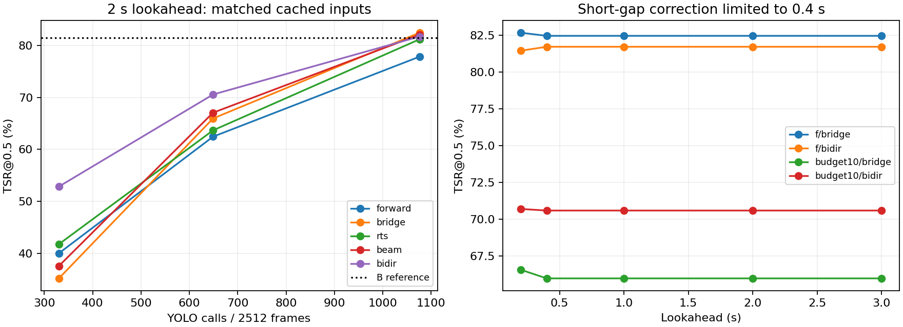

# 条件G：固定遅延とSystem 1 / System 2の実験記録

experiment10全2,512フレーム、可視位置を評価できる1,883フレームを共通分母としたTSR@0.5。候補再生による31比較と、実際にYOLOを呼び出した5回の全動画実験。
実験設計・解釈・再実行手順は [プロジェクトREADMEの条件G](../../README.md#10-条件g固定遅延とsystem-1--system-2) を参照。

## 遅延2秒の方式比較（検出候補を再利用）

| 検出予算 | YOLO回数 | 遅延のみ | 短区間補間 | RTS | Beam | 双方向LK |
|---|---:|---:|---:|---:|---:|---:|
| f | 1076 | 77.85% | 82.47% | 81.20% | 82.10% | 81.73% |
| budget10 | 649 | 62.45% | 65.96% | 63.67% | 67.07% | 70.58% |
| budget5 | 330 | 39.99% | 35.16% | 41.74% | 37.55% | 52.84% |

キャッシュ比較の時間は後処理だけで、YOLO推論込みのFPSではありません。比較した入力が同じ方式間では、YOLO回数は完全に同じです。

## 実推論・全動画測定

| 構成 | ペーシング | 補正前TSR | 補正後TSR | YOLO回数 | 処理fps | 遅延中央値 / p95 / 最大 |
|---|---|---:|---:|---:|---:|---|
| cuda:0 / 960 / f / bridge | 最速 | 77.85% | 82.47% | 1076 | 45.09 | 未測定 |
| cpu / 640 / budget10 / bidir | 最速 | 51.30% | 55.55% | 614 | 22.28 | 未測定 |
| cpu / 416 / budget10 / bidir | 30fps入力 | 27.08% | 32.13% | 562 | 35.49 | 2.077 / 2.969 / 3.435秒 |
| cuda:0 / 960 / budget10 / bidir | 30fps入力 | 62.45% | 70.58% | 649 | 41.01 | 2.023 / 2.090 / 2.324秒 |
| cuda:0 / 960 / f / bridge | 30fps入力 | 77.85% | 82.47% | 1076 | 37.81 | 2.035 / 2.071 / 2.194秒 |

処理fpsは明示的な待ち時間を除いた値です。ペーシングありの測定は30fpsのファイル到着を模擬し、元フレームの到着予定時刻から動画書込み完了までを計測しています。カメラ入力・画面表示までの遅延ではありません。
読み込み、LK、YOLO、補正、描画、ログ・動画保存、末尾出力を含みます。モデル初期化、3回のウォームアップ、終了後の評価は除きます。
表は実行順です。過去のB/E/Fとは計測セッションと計測処理が異なるため、過去のFPSから速度向上率を算出しません。各構成1回ずつの測定であり、統計的な速度差や長時間安定性を示すものではありません。

## 動画と監査記録

動画はローカルの以下のパスです。各動画は元と同じ30fps・2,512フレームで、表示位置の時刻に対応します。冒頭に2秒の黒画面を挿入した映像ではありません。遅延の証拠は各runのrelease.csvです。

- `results/condition_g/fresh/s_G_f_bridge_960_cuda0_20261027T094051778520Z/tracked.mp4`
- `results/condition_g/fresh/s_G_budget10_bidir_640_cpu_20261027T094201212139Z/tracked.mp4`
- `results/condition_g/fresh/s_G_budget10_bidir_416_cpu_20261027T094405897796Z/tracked.mp4`
- `results/condition_g/fresh/s_G_budget10_bidir_960_cuda0_20261027T094905935771Z/tracked.mp4`
- `results/condition_g/fresh/s_G_f_bridge_960_cuda0_20261027T095044774094Z/tracked.mp4`

[検証記録](verification.json)、[キャッシュ比較CSV](cached_comparison.csv)、[実推論CSV](fresh_comparison.csv) を同梱。各runの設定・指標・ソースハッシュは `cached/` と `fresh/` に保存しています。
動画・全フレームログ・重みは大きいためGitに含めません。正解は追跡処理に渡さず、描画と事後評価だけに使用しました。
検証では全動画を最後までデコードし、保存候補だけから因果的な呼び出し判断と固定遅延出力を再現し、位置・イベント・時刻境界・予算・指標の一致を確認しました。

## 解釈の範囲

- experiment10を見て方式を選んだ開発実験です。独立した最終評価でも、汎化性能の証明でもありません。
- 不可視629フレームは確認済みですが、真のボール位置は不明です。そこでの推定位置の正確さは検証できません。
- 2秒先まで参照できても、bridge/bidirが補う区間は最大0.4秒です。この実装での遅延長の頭打ちを、一般の平滑化の限界とは解釈しません。
- 末尾60フレームは2秒分の未来がないためfull_lookahead=false。主要TSRは末尾を含む共通1,883可視フレームで算出し、完全な先読みがある範囲の指標もmetrics.jsonに分けて保存しています。
- CPUは4スレッド。640/416は追加の開発用入力解像度で、valで選ばれた設定ではありません。既存の重み・final_selection.jsonは変更していません。
- 2秒のRGB表示バッファは最大61枚、168,652,800 bytesです。モデル等を含むプロセスメモリは別に記録しています。評価用ログは全動画分を保持するため、長時間配信でメモリ一定とは主張しません。
- 保持選手・姿勢・3D軌道は未使用です。LKは局所追跡であり、画面全体から新規ボールを発見する検出器ではありません。
