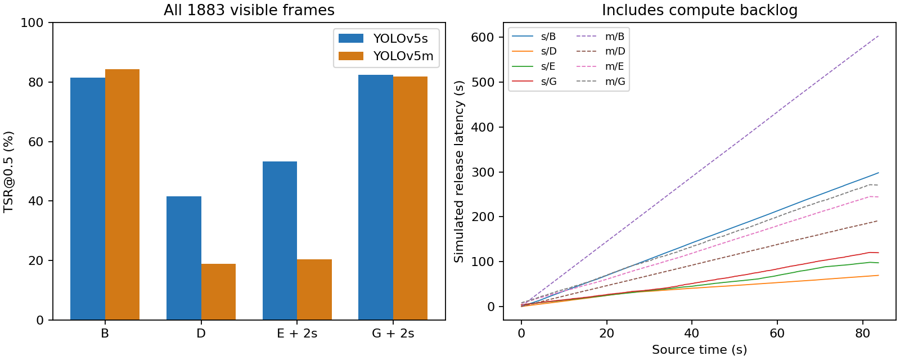

# B・Dと固定遅延ありE・Gの比較（2026-10-28）

EのKCF初期化を修正したうえで、experiment10全2,512フレームをs/m各モデルで計8回、新たに推論しました。主な対象はRTX 3050 Ti Laptop GPU 4GBです。
可視1,883フレームを共通分母とし、元フレームの時刻に対応する推定位置を評価しています。遅れた枠を正解と合わせるために時刻をずらす処理はしません。

## 事前に固定した条件

| 条件 | 前向き処理 | 未来情報の利用 | 設定遅延 |
|---|---|---|---:|
| B | 毎フレームYOLO | なし | 0秒 |
| D | 3フレームごとのYOLO＋位置保持 | なし | 0秒 |
| E | 3フレームごとのYOLO＋修正済みKCF | 後のYOLO位置から逆向きKCF。前向きとの整合性を確認して融合 | 2秒 |
| G | 適応的YOLO＋局所LK＋速度予測（fプロファイル） | 前後のYOLO位置・枠サイズを短区間補間（bridge） | 2秒 |

共通：学習済み同サイズの重み、imgsz=960、confidence=0.25、NMS IoU=0.45、FP32、同じ入力動画・正解、動画とログ保存あり。30fpsファイル到着を模擬し、同じrun_fixed_lag.pyで実行しました。
E/Gの補正区間は最大0.4秒、先読み上限は2秒です。Eの逆向きKCFは強いYOLO検出で初期化し、初回updateをその画像上で済ませます。逆追跡が失敗した部分は前向き結果を残します。
前向き枠がある場合、逆追跡が前のYOLO位置まで戻り、中心誤差がmax(6px, 前の枠の最大辺×0.75)以下なら位置とサイズを時間比率で融合します。前向き出力がない位置は成功した逆追跡で補います。長い遮蔽の真の位置を保証する処理ではありません。
実行順はs/B→s/D→s/E→s/G→m/B→m/D→m/E→m/G、各1回です。キャッシュ済みYOLOによる速度測定ではありません。

m/Gの初回実行は途中で異常終了し、後の確認時にはDドライブが認識されませんでした。因果関係は未確定です。途中記録を別フォルダへ保存し、再接続後の別セッションでm/Gを完走させた結果を掲載します。前7条件とm/Gの速度差にはセッションの違いも含まれるため、厳密に同時条件での速度比較とは扱いません。詳細はinterruption.jsonです。

## 全動画の結果

| モデル | 条件 | TSR@0.5 | 補正前TSR | YOLO回数 | 処理fps | 遅延中央値 / p95 / 最大 |
|---|---|---:|---:|---:|---:|---|
| s | B | 81.47% | 81.47% | 2512 | 6.58 | 148.557 / 282.988 / 297.995秒 |
| s | D | 41.64% | 41.64% | 838 | 16.39 | 41.930 / 66.585 / 69.551秒 |
| s | E | 53.27% | 44.24% | 838 | 13.86 | 47.498 / 96.302 / 98.531秒 |
| s | G | 82.47% | 77.85% | 1076 | 12.33 | 54.246 / 116.543 / 120.548秒 |
| m | B | 84.23% | 84.23% | 2512 | 3.66 | 302.790 / 573.443 / 602.568秒 |
| m | D | 18.80% | 18.80% | 838 | 9.14 | 96.484 / 181.914 / 191.223秒 |
| m | E | 20.45% | 17.10% | 838 | 7.66 | 124.632 / 238.636 / 245.060秒 |
| m | G | 81.84% | 77.43% | 1109 | 7.09 | 139.353 / 264.090 / 271.402秒 |

補正前TSRは同じ実行のオンライン出力です。Eでは初期化修正済み・未来補正なしのKCF、Gでは未来補正なしのF相当の結果です。B/Dでは補正しないため一致します。
処理fpsは読み込み、推論、前向き追跡、逆追跡/補間、描画・保存・ログ、末尾の出力を含み、明示的な待ち時間を除きます。モデル初期化・ウォームアップ3回・終了後の評価は含みません。
遅延は元フレームの到着予定から動画書込み完了までです。計算が30fpsに追いつかなければ蓄積する遅れも含みます。設定遅延0秒は実遅延0秒の意味ではなく、2秒も厳密な表示期限の保証ではありません。カメラ・画面表示までの遅延は未測定です。

今回はユーザー確認済みのバッテリー駆動です（power_context.json）。以前のG計測より低速で、実行中のGPU状態もhardware_observation.jsonに1回記録しています。速度と遅延はこのバッテリー駆動セッションの値で、AC電源時の性能を示しません。低速化の全要因を分離した実験ではなく、過去のFPSと合算・直接比較しません。



## Eの修正と未来補正の効果

| モデル | 旧E（不具合あり・参考） | 修正済みEの前向き出力 | 逆向きKCFで補正後 |
|---|---:|---:|---:|
| m | 19.01% | 17.10% | 20.45% |
| s | 44.34% | 44.24% | 53.27% |

m: 初期化修正前後の保存YOLO候補が完全一致したフレームは2512/2512。修正済み前向きEに対する未来補正の差は+3.35ポイントです。

s: 初期化修正前後の保存YOLO候補が完全一致したフレームは2512/2512。修正済み前向きEに対する未来補正の差は+9.03ポイントです。

OpenCV 4.10.0のKCFは最初のupdateで特徴を学習します。従来のEはinitの次の画像で初回updateを呼び、移動前のROIを移動後の画像で学習していました。検出画像上で初回updateを行うよう修正し、次フレームから探索させます。YOLOの検出枠自体はこの初回updateでは変更しません。
初期化の修正は追跡処理の正しさを直すもので、全動画のTSRが必ず向上するとは限りません。動きが大きい場面で正しく追跡失敗を返す場合もあります。未来補正の効果とは分けて解釈します。
移動する合成画像で、初期化直後・再初期化直後の1フレーム目から追跡できる回帰テストを追加しました。旧結果は削除・上書きせず、不具合を含む履歴として扱います。旧Eの速度や、旧Eに対する過去の改善倍率を今回の比較根拠にしません。

[14秒前後の診断CSV](e_14s_diagnostic.csv) に、旧E・修正済み前向きE・逆向き補正後Eの座標とIoUを保存しています。

## 再実行・検証

プロジェクト直下のPowerShellで実行します。出力先は新しいフォルダ名にしてください。

```powershell
.\.venv\Scripts\python.exe scripts/compare_fixed_lag.py --output results/comparison_fixed_lag_new
.\.venv\Scripts\python.exe scripts/verify_g.py --fresh-root results/comparison_fixed_lag_new --output results/comparison_fixed_lag_new/verification.json
.\.venv\Scripts\python.exe scripts/summarize_fixed_lag.py --root results/comparison_fixed_lag_new --output reports/comparison_fixed_lag_new
```

本体は `src/tracking.py`（Eの修正）、`src/lag_tracking.py`（逆向きKCFと固定遅延補正）、`scripts/run_fixed_lag.py`（共通測定）です。設定・コマンドは各run_config.jsonとcomparison_plan.jsonに保存します。
保存候補と元動画だけから前向き処理・未来補正を再実行し、全フレームの座標、判断、時刻境界、検出スケジュールを照合しました。全出力動画を最後までデコードし、指標も再計算しています。正解は描画と事後評価だけに使用します。

## 動画とデータ

各動画は同じ元時刻の映像に推定枠を重ねています。冒頭の待ち時間や計算の遅れを映像に挿入した動画ではありません。実際の模擬出力時刻はrelease.csvを参照してください。

- s/B: `results/comparison_fixed_lag_20261028/s_B_f_forward_960_cuda0_20261027T163902784175Z/tracked.mp4`
- s/D: `results/comparison_fixed_lag_20261028/s_D_f_forward_960_cuda0_20261027T164601626958Z/tracked.mp4`
- s/E: `results/comparison_fixed_lag_20261028/s_E_f_bidir_kcf_960_cuda0_20261027T164913038822Z/tracked.mp4`
- s/G: `results/comparison_fixed_lag_20261028/s_G_f_bridge_960_cuda0_20261027T165238603535Z/tracked.mp4`
- m/B: `results/comparison_fixed_lag_20261028/m_B_f_forward_960_cuda0_20261027T165631491085Z/tracked.mp4`
- m/D: `results/comparison_fixed_lag_20261028/m_D_f_forward_960_cuda0_20261027T170834310868Z/tracked.mp4`
- m/E: `results/comparison_fixed_lag_20261028/m_E_f_bidir_kcf_960_cuda0_20261027T171342847683Z/tracked.mp4`
- m/G: `results/comparison_fixed_lag_20261028/m_G_f_bridge_960_cuda0_20261028T001200479734Z/tracked.mp4`

4分割比較動画は左上B・右上D・左下E・右下G。同じ元フレームで並べた位置精度の比較で、出力遅延を同期比較する動画ではありません。

- `results/comparison_fixed_lag_20261028/comparison_videos/s_B_D_E_G.mp4`
- `results/comparison_fixed_lag_20261028/comparison_videos/s_12_to_16_seconds.mp4`
- `results/comparison_fixed_lag_20261028/comparison_videos/m_B_D_E_G.mp4`
- `results/comparison_fixed_lag_20261028/comparison_videos/m_12_to_16_seconds.mp4`

[比較CSV](comparison.csv)、[全検証記録](verification.json)、[E修正の比較](e_fix_and_smoothing.csv) と各条件の設定・集計値をGitに保存します。重み、全フレームログ、動画はローカル保存です。

## 解釈の制約

- experiment10で方式を設計した開発比較です。独立した汎化評価ではありません。
- E/Gは未来情報を使える代わりに2秒の遅延を許す条件で、B/Dと同じ応答性ではありません。精度だけで優劣を判断しません。
- Eは838回の周期検出、Gは適応検出なので回数が異なります。これはシステム全体の比較であり、同一検出候補を使ったKCF対LKだけの比較ではありません。
- 629不可視フレームでは真の位置が不明です。不可視区間の出力の正しさは評価できません。
- E/Gの末尾60フレームは未来が不足しfull_lookahead=false。主指標は末尾を含む同じ1,883可視フレームで算出し、完全な先読みがある範囲の指標も別に保存します。
- 位置を出さない場合はTSRの失敗に含めます。CLEは位置を出した可視フレームだけの値なので、方式間で分母が異なります。
- 表示用RGBバッファは2秒条件で最大61枚です。逆KCFは別に最大13枚のRGBを持ちます。プロセスメモリはモデルや全動画分の評価ログも含むため、長時間配信のメモリ一定性は未検証です。
- 電力・温度・実行順を完全には統制していない各1回の測定です。速度差の統計的優位性や15分連続運転の保証はありません。
