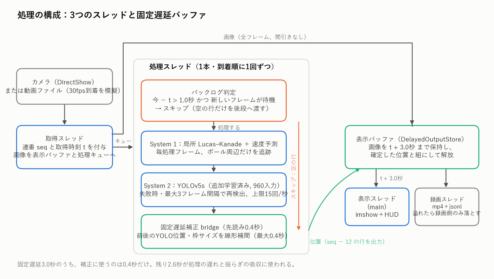
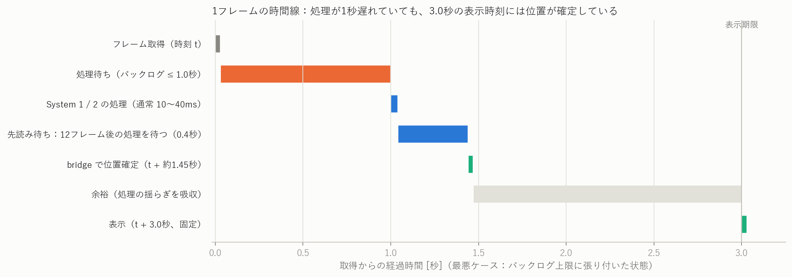
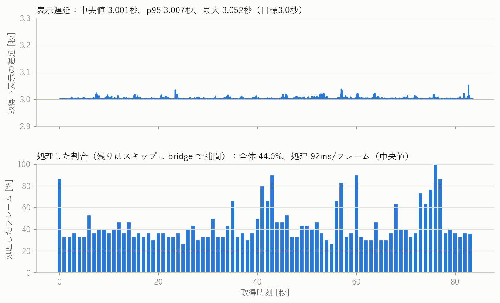
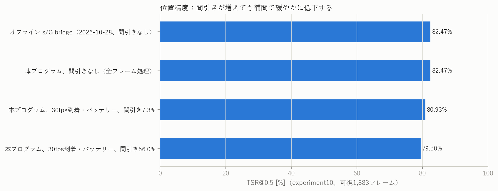

# リアルタイム固定遅延追跡（3秒遅延）のアルゴリズム説明

`scripts/realtime_tracking.py` は、録画データで最も精度が高かった固定遅延方式 **YOLOv5s＋条件G（fプロファイル＋bridge補間）** を、カメラ入力に対して固定遅延3.0秒で動かすプログラムです。処理が30fps入力に追いつかない場合は、遅延を溜めるのではなく、古い未処理フレームを間引いて補間で埋めます。本資料はその仕組みと、2026-11-16に測定した挙動をまとめます。

## 1. 選んだ方式と根拠

[2026-10-28の比較](../2026-10-28-fixed-lag-comparison/README.md) で、固定遅延ありの条件ではs/G（bridge）がTSR@0.5＝82.47%で最良でした。毎フレームYOLOv5m（B）は84.23%で数値上は上ですが、RTX 3050 Tiでは3.7〜15fps程度で、30fps入力の大半を捨てる前提になります。s/GはAC電源時に37.8fpsで30fpsに追随した記録があり（[条件Gの実験](../2026-10-27-condition-g/README.md)）、固定遅延の枠組みも評価済みです。

| 項目 | 値 | 出典 |
|---|---|---|
| 検出器 | 追加学習済みYOLOv5s、imgsz=960、conf=0.25、FP32 | `weights/finetuned/s/`、val確定設定 |
| 前向き処理 | `AdaptiveBallPolicy`（局所LK＋速度予測＋適応再検出、上限15回/秒） | `src/adaptive_tracking.py` |
| 未来補正 | `FixedLagBall(method='bridge')`、補間は最大0.4秒 | `src/lag_tracking.py` |
| 固定遅延 | 表示は取得の3.0秒後 | 本プログラムの `--delay` |

評価済みのSystem 1 / 2と補正コードはそのまま使い、新規に書いたのは「時刻と間引きの管理」「表示バッファ」「スレッド構成」です（`src/realtime.py`、`scripts/realtime_tracking.py`）。

## 2. 全体の構成



3本のスレッドと1つの固定遅延バッファで構成します。

| 担当 | 役割 | 実装 |
|---|---|---|
| 取得スレッド | カメラ（または30fps到着を模擬した動画ファイル）から読み込み、連番 `seq` と取得時刻 `t` を付ける。画像を表示バッファと処理キューの両方へ渡す | `capture_loop` |
| 処理スレッド | キューから到着順に取り出し、バックログ判定→System 1 / 2→bridge補正を行う。`seq−12` の位置が確定したら表示バッファへ渡す | `TrackingWorker.step` |
| 表示スレッド（main） | `t + 3.0秒` を過ぎたフレームを表示バッファから取り出し、確定済みの位置を描いて表示する | `run()` の主ループ |
| 録画スレッド（任意） | 遅延後の映像をmp4へ、各フレームの位置と時刻をjsonlへ保存する。溢れたら録画側だけを落とし、表示と処理を止めない | `RecordingWriter` |

## 3. 時刻の扱い：3.0秒のうち補正に使うのは0.4秒



bridgeは前後のYOLO位置を最大0.4秒まで補間する方式で、[条件Gの実験](../2026-10-27-condition-g/README.md) では遅延0.4秒以上なら結果が同一でした。そこで、固定遅延3.0秒を次の2つに分けます。

- **先読み0.4秒（`--lookahead`）**：`FixedLagBall` の遅延量です。フレーム `seq` の位置は、`seq+12`（30fpsで0.4秒後）のフレームが処理された時点で確定し、以後変更しません。
- **残り2.6秒**：処理の遅れと揺らぎを吸収する余裕です。処理が最大1.0秒遅れていても（`--max-backlog`）、`t + 約1.45秒` には位置が確定し、`t + 3.0秒` の表示に間に合います。

表示時刻は取得時刻から機械的に決まるため、処理が遅くても表示遅延そのものは伸びません。処理が表示時刻に間に合わなかったフレームは「結果なし」として枠なしで表示し、`missing_results` に数えます（今回の測定では0件）。

## 4. 各段の処理

### 4.1 バックログ判定（間引き）

処理スレッドは取り出したフレームの `今 − t`（バックログ）を見て、

- **1.0秒を超え、かつ新しいフレームがキューで待っている**ときだけスキップします。
- スキップしたフレームも、空の行（`source='dropped'`）として `FixedLagBall` に順番どおり渡します。フレーム番号は欠番にしません。
- 待っているフレームがなければ、古くても処理します（捨てても得がないため）。

処理が30fpsに追いつかない定常状態では、バックログが1.0秒に張り付き、処理1回ごとに溜まった分だけ古いフレームが落ちて、実質的に一定間隔の間引きに収束します。一時的な遅れ（YOLO呼び出しの集中など）は1.0秒の範囲で吸収し、間引きません。

### 4.2 System 1：局所Lucas–Kanade＋速度予測

処理したフレームの間だけで、前回処理した画像からボール周辺の特徴点を追跡します。間引きが起きると前回との間隔が広がりますが、追跡の信頼性が下がれば `flow_unreliable` としてSystem 2を前倒しで呼ぶ既存の仕組みがそのまま働きます。評価時と同じコードで、閾値も変えていません。

### 4.3 System 2：YOLOv5s再検出

既存の予算制御（連続1秒に15回まで、通常は最大3フレーム間隔）をカメラのフレーム番号で数えるため、間引きがあっても「1秒あたりの上限」は変わりません。候補の選択（信頼度・移動量・大きさ）も評価時と同じです。

### 4.4 固定遅延補正（bridge）

`seq+12` まで行が揃った時点で、`seq` の前後にあるYOLO位置が0.4秒以内なら、位置と枠サイズを時間比で線形補間します。間引いたフレーム（空の行）もこの補間で埋まります。前後のYOLO位置が0.4秒以上離れていれば補間せず、前向き出力（LK・予測・なし）をそのまま使います。評価時と同じく、急な動きや長い遮蔽を無理に埋めることはしません。

### 4.5 表示バッファ

`DelayedOutputStore` は画像を `t + 3.0秒` まで保持し、表示時刻が来たものを古い順に解放します。表示スレッドは解放されたうち最新のものを描き、録画はすべてを順番どおり書きます。表示スレッド自体が止まっても、`t + 4.0秒`（`--delay + --hold-margin`）を過ぎた画像は破棄してメモリを上限内に保ちます（`discarded_unreleased`）。

## 5. 遅延を溜めないための3つの工夫

1. **表示時刻を取得時刻から固定する。** 処理の遅れは表示遅延ではなく「結果が間に合うか」に変換されるため、遅延そのものが蓄積しません。
2. **処理キューのバックログに上限（1.0秒）を置き、超えた分を間引く。** 間引いた位置はbridgeで補間し、フレーム番号は保ちます。
3. **録画エンコードを処理・表示から分離する。** 当初はメインスレッドで録画しており、CPU競合で処理が遅れ、表示解放も最大0.47秒遅れました。録画を専用スレッドに移し、溢れた場合は録画側だけを落とすことで、表示遅延のp95が3.475秒から3.007秒に改善しました。

## 6. 実測（2026-11-16、バッテリー駆動）

**今回の測定はすべてバッテリー駆動です。** GPUクロックは1,035MHz（上限2,100MHz、P3状態）で、検出器単体が82ms/回（前処理22ms＋推論51ms＋後処理15ms）でした。AC電源時のs/Gは37.8fpsで30fpsに追随した記録があるため、AC電源なら間引きはほぼ発生しない見込みですが、本日は未測定です。

### 6.1 experiment10を30fps到着として処理（`--video`、録画あり）



| 指標 | 値 |
|---|---|
| 取得フレーム | 2,512（83.7秒） |
| 処理 / 間引き | 1,106（44.0%） / 1,406（56.0%） |
| YOLO呼び出し | 850回 |
| 処理時間（処理したフレームのみ） | 中央値 91.7ms、p95 119ms |
| バックログ | 中央値 1.007秒（上限1.0秒に張り付き） |
| 取得→表示の遅延 | 中央値 3.001秒、p95 3.007秒、最大 3.052秒 |
| 結果確定から表示までの余裕 | 中央値 1.56秒 |
| 表示時に結果がなかったフレーム | 0 |

出力先：`results/realtime_dev/realtime_20261116T053907888371Z/`（`frames.jsonl`、`session.json`、`delayed.mp4`、`evaluation.json`）。

### 6.2 位置精度（正解データは事後評価のみに使用）



| 条件 | 間引き率 | TSR@0.5 | TSR@0.3 | 出力率 |
|---|---:|---:|---:|---:|
| オフラインs/G bridge（2026-10-28、間引きなし） | 0% | 82.47% | 92.35% | 98.09% |
| 本プログラム、間引きなし（時刻を止めて全フレーム処理） | 0% | 82.47% | 92.35% | 98.09% |
| 本プログラム、30fps到着・バッテリー（録画をメインスレッドで実行した旧版） | 7.3% | 80.93% | 91.24% | 98.04% |
| 本プログラム、30fps到着・バッテリー（最終版、上の6.1） | 56.0% | 79.50% | 89.59% | 95.75% |

半数以上を間引いても補間により3ポイント程度の低下にとどまりました。ただし、間引きの影響はボールの動きの速さに依存するため、この数値を別の試合へ一般化しません。

間引きなしの確認は `scripts/check_realtime_equivalence.py` で行いました。時刻を止めて全フレームを `TrackingWorker` に通し、オフラインのs/G実行（`results/comparison_fixed_lag_20261028/s_G_f_bridge_960_cuda0_20261027T165238603535Z/tracking.jsonl`）と比べると、2,512フレームすべての枠が完全一致し、YOLO呼び出しも1,076回で同じでした（[equivalence.json](equivalence.json)）。先読みを2秒から0.4秒へ短くしても出力は変わりません。

### 6.3 実カメラでの動作確認（20秒、内蔵カメラ、1280×720、録画あり）

| 指標 | 値 |
|---|---|
| 取得 | 577フレーム / 20.5秒（約28fps） |
| 間引き | 0（処理は中央値2.1ms、YOLO実行時は約100ms） |
| 取得→表示の遅延 | 中央値 3.001秒、p95 3.002秒 |
| 表示時に結果がなかったフレーム | 0 |

内蔵カメラの映像にボールは写っていないため、追跡精度の確認ではなく、カメラ入力・スレッド・固定遅延表示が動くことの確認です。カメラ内部とUSB転送、モニタ表示の遅延は測っていません。

## 7. 使い方

`basketball_tracking_midterm` 直下のPowerShellで、既存の `.venv` と `weights/finetuned/s/` を使います。

```powershell
# カメラ入力、3秒遅延で表示。q または Esc で終了
.\.venv\Scripts\python.exe scripts/realtime_tracking.py --camera-index 0 --width 1280 --height 720 --fps 30

# 録画・ログも保存（delayed.mp4、frames.jsonl、run_config.json、session.json）
.\.venv\Scripts\python.exe scripts/realtime_tracking.py --camera-index 0 --record results/realtime_sessions

# 動画ファイルを30fps到着として処理し、画面表示なしで保存（検証用）
.\.venv\Scripts\python.exe scripts/realtime_tracking.py --video "../編集済み元データ/experiment10_編集.mp4" --no-display --record results/realtime_dev

# experiment10の保存結果を正解データで採点
.\.venv\Scripts\python.exe scripts/evaluate_realtime_log.py results/realtime_dev/realtime_<timestamp>

# 本資料の図を再生成
.\.venv\Scripts\python.exe scripts/draw_realtime_figures.py --session-run results/realtime_dev/realtime_<timestamp> --accuracy reports/2026-11-16-realtime-fixed-delay/accuracy.json
```

| オプション | 既定 | 意味 |
|---|---|---|
| `--delay` | 3.0 | 取得から表示までの固定遅延（秒） |
| `--lookahead` | 0.4 | 補正の先読み（秒）。`--max-bridge` 以上 |
| `--max-backlog` | 1.0 | これより古い未処理フレームは、新しいものが待っていれば間引く（秒）。`--lookahead + --max-backlog <= --delay` が必要 |
| `--hold-margin` | 1.0 | 表示が止まった場合に画像を破棄するまでの猶予（秒） |
| `--display-scale` | 1.0 | 表示ウィンドウの縮尺 |
| `--duration` | 0 | 指定秒数で自動終了（0は手動終了） |
| `--size` / `--profile` / `--imgsz` / `--device` | s / f / 960 / cuda:0 | 評価時と同じ既定。変更時は精度の根拠が変わる |

画面の枠の色：緑＝YOLO検出そのもの、橙＝bridge補間（YOLOフレーム自身も補間経路を通ると橙）、黄＝LKまたは速度予測。HUDには遅延、処理fps、YOLO回数/秒、バックログ、間引き数、表示時に結果がなかった数を出します。

## 8. 制約と注意

- 表示遅延は「取得スレッドが `cap.read()` から戻った時刻」からの時間です。カメラ内部の露光・転送とモニタ表示の遅延は含みません。
- 位置精度はexperiment10での開発評価です。方式はこの動画を見て選んでおり、別試合・別体育館への汎化は未確認です。
- 間引きが起きるとSystem 1の速度の単位（処理1回あたりの移動量）が広がり、YOLO間隔から求める速度（1フレームあたり）と混ざります。この不一致は再検出の前倒しという安全側に働きますが、間引き率が高いときの精度は上で示した範囲でしか確認していません。
- 3.0秒の遅延のうち位置の補正に使うのは0.4秒です。残りは余裕として使っており、2秒以上の文脈で保持者や誤候補を判断する処理は含みません。
- バッテリー駆動では処理が約12fpsまで落ち、半数以上を間引きます。体育館で使う場合はAC電源を前提にしてください。
- 長時間運用では統計用の配列（処理時間・遅延）を直近18,000フレーム（10分）に制限していますが、`frames.jsonl` は録画中増え続けます。15分以上の連続運用はまだ試験していません。

## 9. 関連ファイル

- `src/realtime.py`：`TrackingWorker`（バックログ判定・System 1/2・補正の呼び出し）、`DelayedOutputStore`（固定遅延バッファ）
- `scripts/realtime_tracking.py`：カメラ・動画入力、スレッド構成、表示、録画
- `scripts/evaluate_realtime_log.py`：experiment10の保存結果をTSRで採点
- `scripts/draw_realtime_figures.py`：本資料の図
- `scripts/check_realtime_equivalence.py`：間引きなし条件でオフラインs/Gと同一出力になることの確認（約2〜4分、GPU使用）
- `tests/test_realtime.py`：間引き判定、空の行の順序、補間、固定遅延解放、メモリ上限の回帰テスト（`python -m unittest discover -s tests`）
